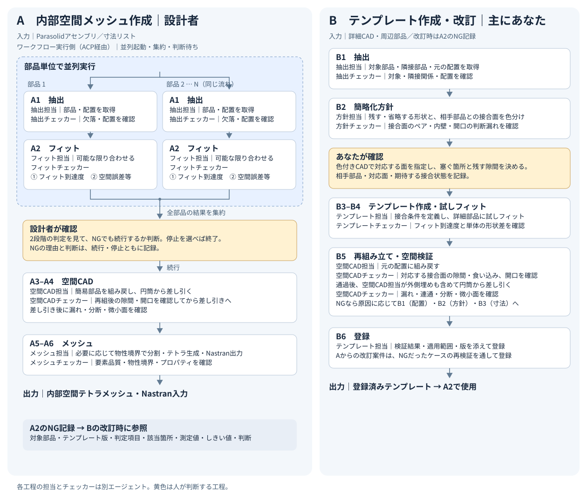
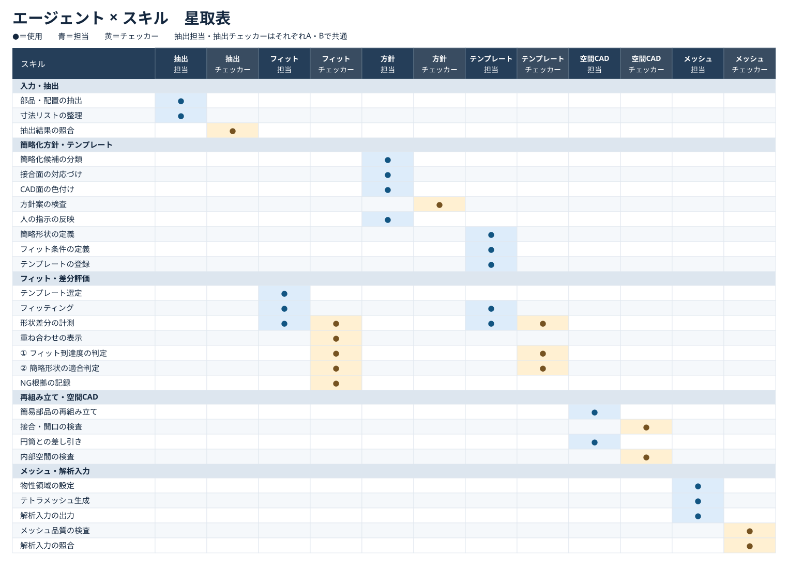
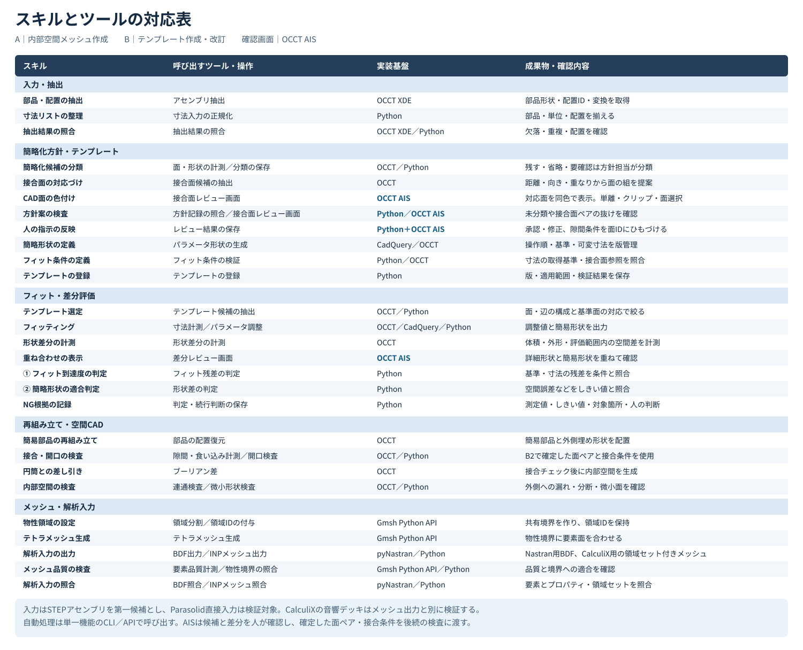

# 機械の内部空間を対象とした音響FEMメッシュ生成仕様

## 1. 目的と入出力

詳細な機械アセンブリを音響解析に必要な形状へ簡略化し、内部空間のテトラメッシュを生成する。微小面・微小辺による空間CAD作成とメッシュ生成の手戻りを減らし、解析に必要な内壁、開口、接合部、物性境界を保持する。

| 項目 | 内容 |
|---|---|
| 詳細形状入力 | 複数部品を含む単一のParasolidアセンブリを想定する。OSS構成では元CADから出力したSTEPアセンブリを初期候補とし、Parasolid直接入力は実ファイルで検証する。 |
| 寸法入力 | 部品別寸法、単位、配置を含む寸法リストも使用できる。詳細CADに依存する差分は、比較対象がある場合に計測する。 |
| 解析空間 | 基本は円筒から簡易部品を差し引く。ケーシング外側は円筒を越えるまで延ばすか、外側埋め用テンプレートで埋める。 |
| 出力 | 内部空間のテトラメッシュと、領域・境界の識別情報。現行はNastran向けBDF。将来はCalculiX向けINPメッシュも出力する。 |

## 2. ワークフローと担当割り

Aは設計者が使うメッシュ作成工程、Bはテンプレート管理者が主に使う作成・改訂工程とする。各工程で作業担当とチェッカーを別エージェントに割り当てる。A・Bの抽出担当は共通とし、抽出チェッカーも同様に共通とする。

### A｜内部空間メッシュ作成

| 工程 | 作業とチェック |
|---|---|
| A1 抽出 | 部品と配置を取り出し、欠落・重複、単位、位置・姿勢を照合する。同一形状が複数ある場合も配置ごとに識別する。 |
| A2 フィット | 部品ごとにテンプレートを選び、可変寸法を調整する。チェッカーは、① テンプレートの調整範囲内で可能な限りフィットできたか、② フィット後の形状が空間誤差などの基準を満たすか、を順に判定する。 |
| A2後 設計者判断 | 全部品の判定を一覧で確認し、必要な箇所は重ね合わせで見る。NGでも続行するか停止するかは設計者が決める。 |
| A3 再組み立て | 簡易部品を元の配置に戻し、接合部の隙間・食い込みと、残すべき開口を検査する。 |
| A4 空間CAD | A3の検査通過後に円筒から部品と外側埋め形状を差し引く。外側への漏れ、意図しない連通・分断、微小面・微小辺を検査する。 |
| A5–A6 メッシュ・出力 | 必要に応じて物性境界で領域を分割し、境界面に沿ってテトラを生成する。要素品質、領域とプロパティの対応、出力ファイルでの割り当てを確認する。 |

A1・A2は部品単位で並列に進め、全部品の結果を集約してから設計者の判断へ進む。空間誤差が設定値（例として xx cc）以上なら、フィッティングが成立していても適合判定はNGとする。体積・外形寸法・局所差分を確認できるようにし、空間誤差は評価範囲を定めて増加分と減少分を別々に計測する案を検証する。

NGの記録には対象部品、テンプレート版、判定項目、測定値としきい値、該当箇所、設計者の続行・停止判断を含める。続行時も記録を残し、Bの改訂で参照できるようにする。

### B｜簡略形状テンプレート作成・改訂

| 工程 | 作業とチェック |
|---|---|
| B1 抽出 | 対象部品、必要な隣接部品、元の配置を取り出して照合する。改訂時はAのNG記録を対象部品にひもづける。 |
| B2 簡略化方針 | 残す面、省略する形状、要確認箇所を分類する。詳細CADの元の配置で、面間距離、面の向き、重なる範囲から接合面の候補を自動提案する。片側の複数面が一つの接合を構成する場合も扱う。チェッカーは内壁、開口、接合面に判断漏れがないか確認する。 |
| B2後 方針の確定 | テンプレート管理者が色付きCADで候補を確認・修正し、残す・省略する形状と、塞ぐ接合部・隙間を残す接合部を確定する。 |
| B3–B4 作成・試しフィット | 基準面・基準軸、可変形状、寸法の取得方法、接合条件を定義する。詳細部品に試しフィットし、到達度と簡略形状の適合を別のチェッカーが確認する。 |
| B5 再組み立て・空間検証 | 元の配置に戻し、確定した面の組で隙間・食い込み・開口を検査する。通過後に外側埋めも含めて円筒から差し引き、漏れ・連通・分断・微小面を検査する。 |
| B6 登録 | 検証結果、適用範囲、判定基準、版を付けて登録する。AのNGを受けた改訂では、そのケースも再検証する。 |

テンプレートは基本の面・辺の構成が同じ部品群を対象とし、穴の径・位置、肉抜き形状、全体寸法などの違いを扱う。簡略ソリッドは寸法と作成履歴から新規生成する。テンプレートの操作順とパラメータを版管理し、途中形状も再生成できるようにする。詳細CADはB2の方針・接合面の参照やB4の計測に使う。接合面は意味のある面名で参照し、演算で面が分割・変更される場合はOCCTの演算履歴も利用する方針とする。寸法変更後に対応面を一意に特定できないときはBで再確認する。初期版は1レベルで、将来のレベル選択では接合面の名前と役割を共通にする。

簡略化部品の寸法は5〜200 mmを目安とする。5 mm以下のフィーチャーは省略候補とし、接合・開口などに必要なものは寸法にかかわらず残す。例外や残す形状はB2からB3に渡す簡略化メモに記録する。

B5の差し戻し先は、配置に原因があればB1、残す面や接合の方針に原因があればB2、寸法やフィット条件に原因があればB3とする。

## 3. スキルとエージェント

行に27のスキル、列に12のエージェントを示す。印のある交点が各エージェントの使用スキルを表す。作業結果と判定根拠を成果物として渡し、チェッカーが独立に照合する。

## 4. スキルとツール

- **OCCT／XDE**で形状・配置の取り込み、幾何計測、ブーリアン演算、形状検査を行う。
- **CadQuery**はテンプレートの再生成に使う第一候補とし、操作順、可変寸法、接合面の参照を実部品で試す。
- **OCP Viewer（three-cad-viewer）**を通常のCAD閲覧とCodexの確認画像に使う。接合面の参照と判断を保存するB2画面は、Webとの連携が検証できるまでQt/AISを使う。候補生成と幾何判定は画面から独立させる。
- **Gmsh**で共有境界に適合するテトラを生成し、領域・境界IDを保持する。たとえば x−側と x＋側を別領域にし、境界で節点と要素面を共有させる。
- **pyNastran**でBDFを書き出し、領域IDからNastranのプロパティIDへ対応づける。読み戻しで割り当てを照合する。
- **CalculiX**は共通メッシュから専用のINP出力を行う方針とする。節点、要素、領域別の要素セット、必要な境界面の情報を保持する。音響解析用デッキの生成方法は、物性・境界条件の対応を確認して決める。

自動処理は抽出、フィット、差分計測、接合検査、円筒差、メッシュ生成、出力などの単一機能に分け、CLIまたはAPIで呼び出す。形状・メッシュはファイル、測定値・判定・人の判断は構造化データで渡す。並列実行、合流、判断待ち、再開はワークフロー実行側が管理する。Kiro CrewとCodexはいずれも実行候補とし、必要に応じて同じツールにMCPアダプターを追加する。

## 5. 確認画面の初期仕様

| 画面 | 初期機能 |
|---|---|
| B2 接合面レビュー | 候補一覧から選ぶと両部品の対応面を同色で強調する。対象2部品の単離表示とクリップ平面で隠れた面を確認する。候補の承認・除外、面の選び直し、期待する接合状態と許容範囲の入力を行う。 |
| A2 フィット結果レビュー | 全部品の2段階判定、NG項目・測定値・しきい値を一覧表示する。必要な部品を選んで詳細・簡易形状を重ね合わせ、続行・停止を記録する。 |

B2では部品配置ID、対応面の組、期待する接合状態、許容範囲、確認結果を保存する。再読込時に同じ面の組を表示でき、B3のフィット条件とB5の隙間検査で使えることを初期版の受け入れ条件とする。

## 6. 実装前に確認する項目

1. **入力変換**。実アセンブリで部品数、配置、単位、体積、接合面を元CADと照合する。
2. **テンプレートとAIS**。実部品一組で接合面の自動提案、修正、保存、再表示、寸法変更後の追跡、B5の検査まで通す。
3. **誤差判定**。空間が増減して総体積差が小さくなる例や、開口が塞がる例で、差分計測と接合・開口検査を確認する。
4. **ソルバー出力**。2物性のメッシュで界面の共有と要素の割り当てを照合する。Nastranで既知の音響モデルを解き、CalculiXは一様空洞と2領域モデルで必要な音響条件を確認する。
5. **並列実行と再開**。2部品を並列処理し、片方がNGでも、設計者の続行判断を記録してA3から再開できることを確認する。
